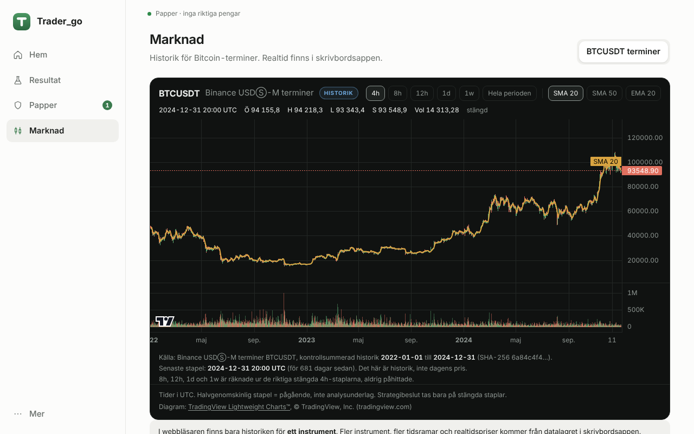
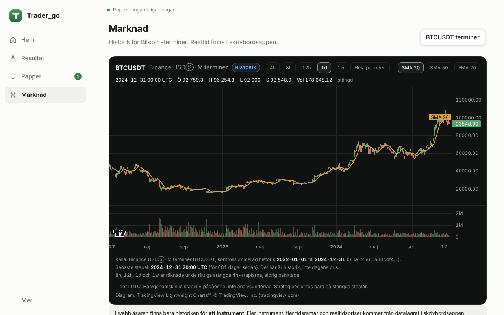
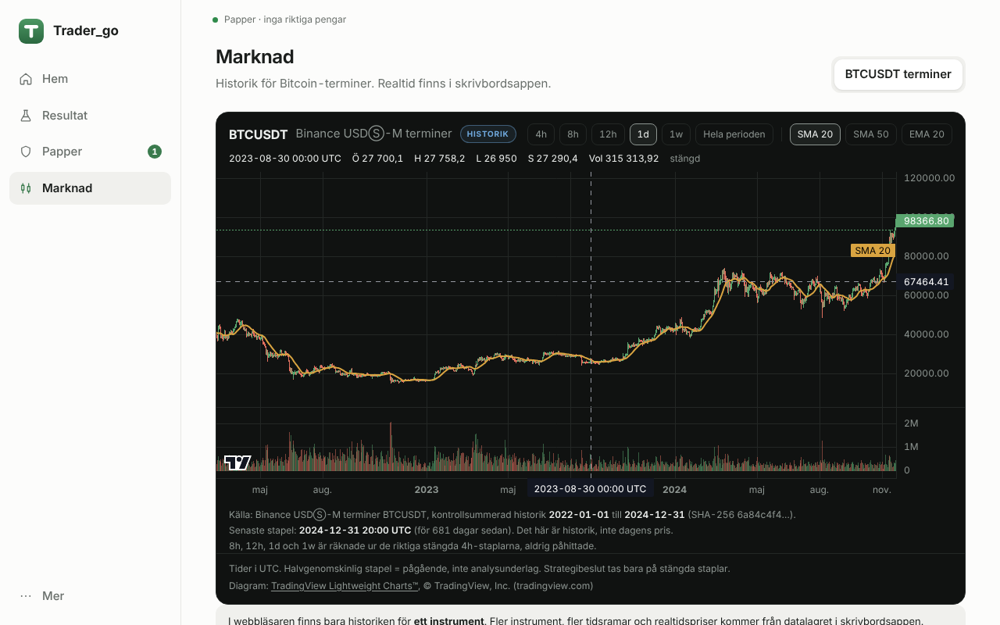
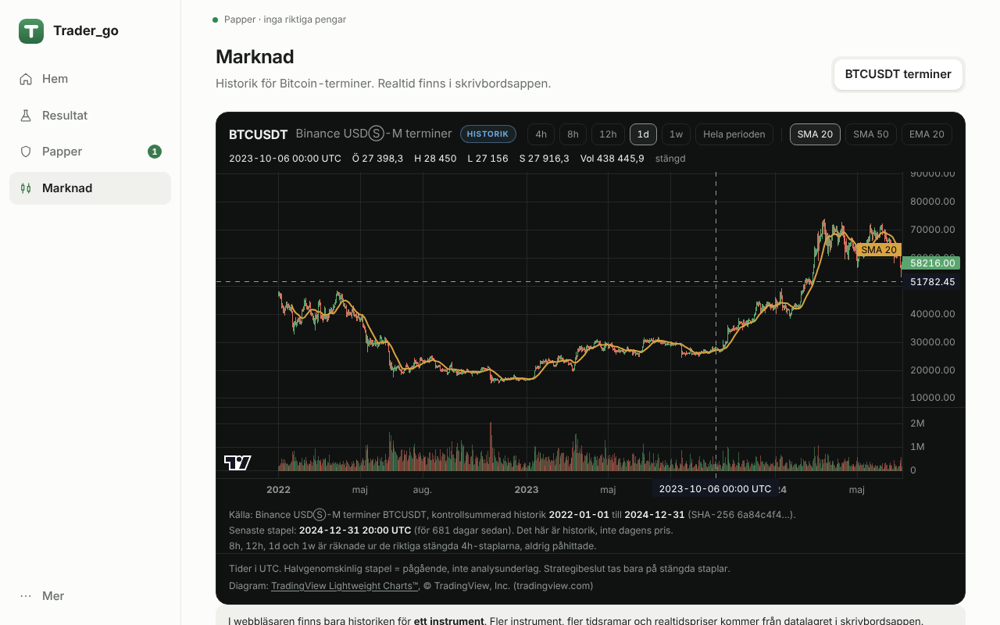
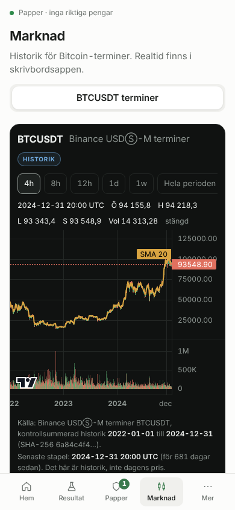
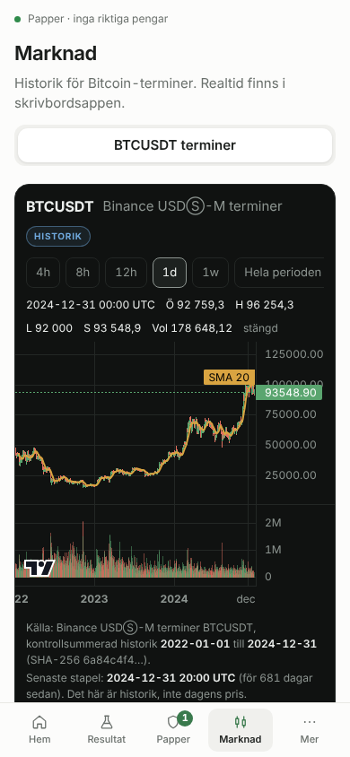
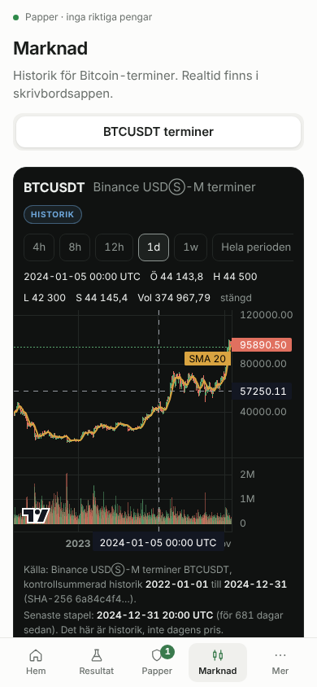
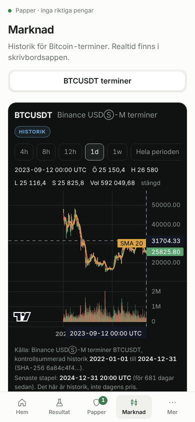

# Förenkling av Trader_go-appen: före och efter

Skärmbilder tagna i Chromium mot produktionsbygget (`npm run build` + `vite preview`), ljust tema om inget annat anges.
**Provat i webbläsaren, inte i Windows-appen (Tauri).** Samma kod ligger bakom båda, men skrivbordsfliken "Egna affärer" kräver Tauri-bryggan och syns därför inte här.

## Startsidan

| Före, 1280×800 | Efter, 1280×800 |
|---|---|
|  |  |

| Före, 390×844 | Efter, 390×844 |
|---|---|
|  |  |

Före: sex menyval, byggcommit i toppraden, fyra forskningsmått, tre "närmast målet"-kort, BTC-graf och sju livscykelsteg. Mobil: hela sidan skars av (fast minsta bredd 760 px).
Efter: tre mått (historiska tester, papperportfölj, datans aktualitet), en huvudhandling, ogiltiga försök och gammal data synliga direkt, resten bakom "Visa detaljer".

## Resultat

| Före, 1280×800 | Efter, 1280×800 |
|---|---|
|  |  |

| Före, 390×844 | Efter, 390×844 |
|---|---|
|  |  |

"REJECT" heter nu "Klarade inte testkraven", och en idé med positiv historisk avkastning (till exempel +780 %) säger fortfarande rätt sak: den klarade inte kraven.

## Status, Mer och Papper

| Före | Efter |
|---|---|
|  |  |

| Mer, 1280×800 | Mer, 390×844 | Papper, 1280×800 | Papper, 390×844 |
|---|---|---|---|
|  |  |  |  |

## Mörkt tema

| 1280×800 | 390×844 |
|---|---|
|  |  |

## Marknad: interaktiv candlestick-graf (TradingView Lightweight Charts)

Grafen finns kvar på Marknad (flyttad från startsidan, inte borttagen). Riktig candlestick-graf med pris- och tidsaxlar, korshår med öppning/högsta/lägsta/stängning/volym, tidsramsval, zoom och panorering. Ingen statisk bild.

| 1280×800: start (4h) | 1280×800: 1d | 1280×800: zoom | 1280×800: panorering |
|---|---|---|---|
|  |  |  |  |

| 390×844: start (4h) | 390×844: 1d | 390×844: zoom | 390×844: panorering |
|---|---|---|---|
|  |  |  |  |

**Instrument och tidsramar (det som faktiskt finns i datalagret):**
- *Datorprogrammet:* instrumenten kommer från datalagret (`market_series`) men **bara Binance spot (BTCUSDT, ETHUSDT) erbjuds**, eftersom insamlingen, `market_bars` och valideringen i Rust bara stöder spot. Samma symbol på en annan marknad erbjuds aldrig, och diagrammet vägrar rita en serie som inte är spot (ingen felmärkt graf). Tidsramarna är de som instrumentet har. Realtid via insamlingen.
- *Webbläsaren:* datalagret finns inte, men appen innehåller kontrollsummerad historik för **ett** instrument, Binance USDⓈ-M terminer BTCUSDT, 4h, 2022-01-01 till 2024-12-31 (SHA-256 `6a84c4f4…`). Tidsramarna 8h, 12h, 1d och 1w räknas ur de riktiga stängda 4h-staplarna (första öppning, högsta, lägsta, sista stängning, summerad volym; en ofullständig period fylls aldrig ut). Instrumentvalet visar därför bara ett val, och begränsningen står i bilden. Inga påhittade staplar.
- *Källa, aktualitet, datafel:* källa, period, SHA-256, senaste stapel och "historik, inte dagens pris" visas under grafen. Ogiltiga priser, luckor eller dubbletter i serien ger ett varningsfält och ingen graf. Fel i datalagret (datorprogrammet) visas som varning.
- *Attribution:* "Diagram: TradingView Lightweight Charts™, © TradingView, Inc." med länk till tradingview.com syns under varje graf (utan klickbar länk i datorprogrammet, eftersom Tauri-fönstret inte har någon extern länkhantering), plus bibliotekets egen logotyp i hörnet.

**Plattformar som grafkravet är verifierat på:**
- Webbläsare (Chromium mot produktionsbygget) vid 1280×800 och 390×844: graf, tidsramsval (4h/8h/12h/1d/1w), mushjulszoom och dragpanorering körda i en riktig webbläsare (bilderna ovan). Pekgester (nypning) är **inte** automatiskt provade; biblioteket stödjer dem men jag har inte testat dem på en fysisk enhet.
- Datorprogrammet (Tauri): instrumentval, tidsramsval från datalagret och felvisning är provade i enhetstester med ersatt datalager. **Inte provat i Windows-appen eller mot en riktig datamapp.**
