# Förenkling av Trader_go-appen: före och efter

Skärmbilder tagna i Chromium mot produktionsbygget (`npm run build` + `vite preview`), ljust tema om inget annat anges.
**Provat i webbläsaren, inte i Windows-appen (Tauri).** Samma kod ligger bakom båda, men skrivbordsfliken "Egna affärer" kräver Tauri-bryggan och syns därför inte här.

## Startsidan

| Före, 1280×800 | Efter, 1280×800 |
|---|---|
| 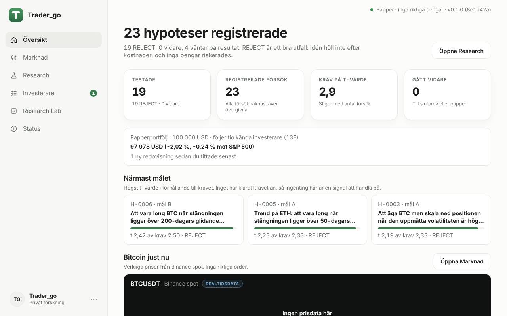 | 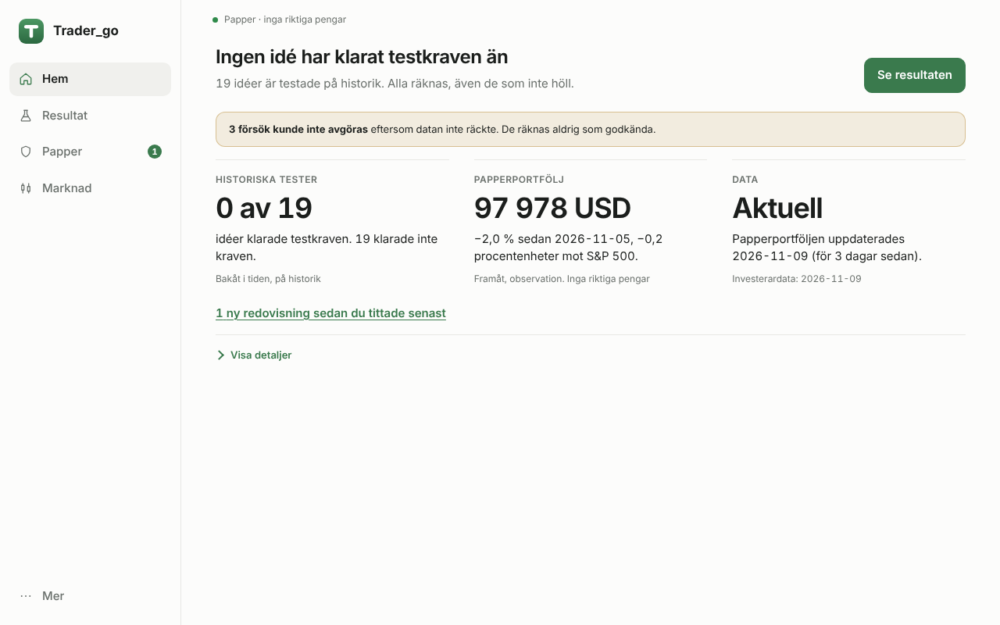 |

| Före, 390×844 | Efter, 390×844 |
|---|---|
| 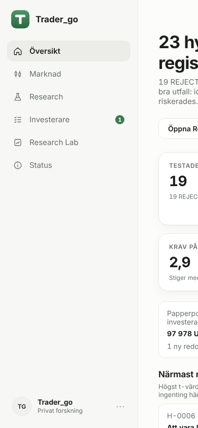 | 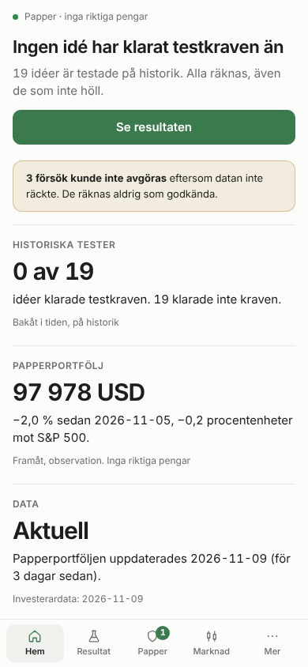 |

Före: sex menyval, byggcommit i toppraden, fyra forskningsmått, tre "närmast målet"-kort, BTC-graf och sju livscykelsteg. Mobil: hela sidan skars av (fast minsta bredd 760 px).
Efter: tre mått (historiska tester, papperportfölj, datans aktualitet), en huvudhandling, ogiltiga försök och gammal data synliga direkt, resten bakom "Visa detaljer".

## Resultat

| Före, 1280×800 | Efter, 1280×800 |
|---|---|
| 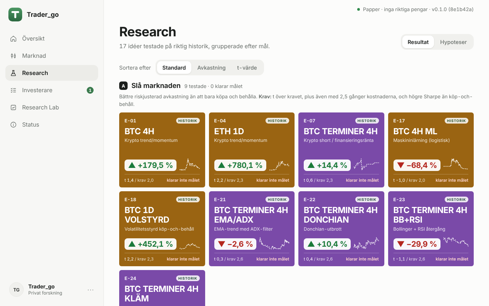 | 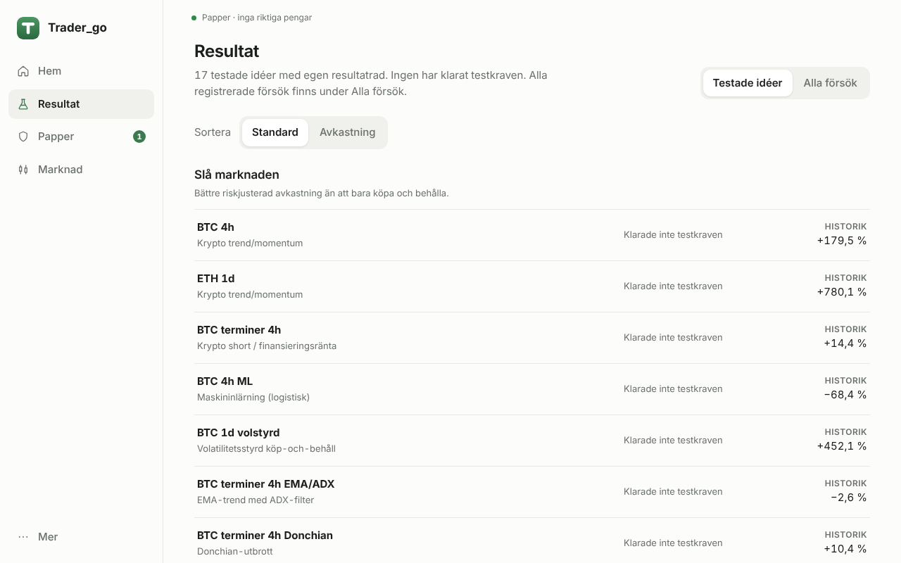 |

| Före, 390×844 | Efter, 390×844 |
|---|---|
| 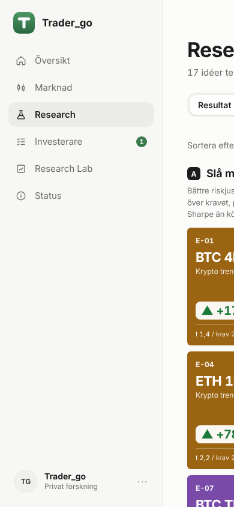 | 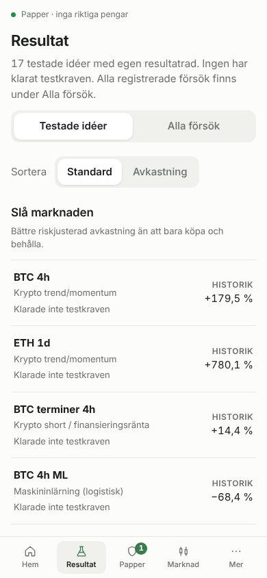 |

"REJECT" heter nu "Klarade inte testkraven", och en idé med positiv historisk avkastning (till exempel +780 %) säger fortfarande rätt sak: den klarade inte kraven.

## Status, Mer och Papper

| Före | Efter |
|---|---|
| 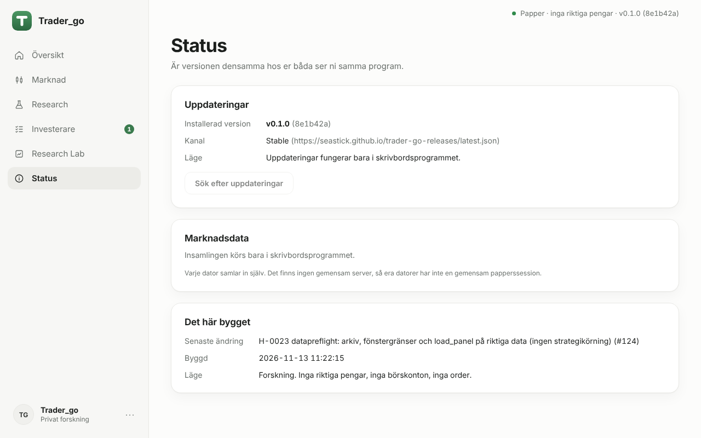 | 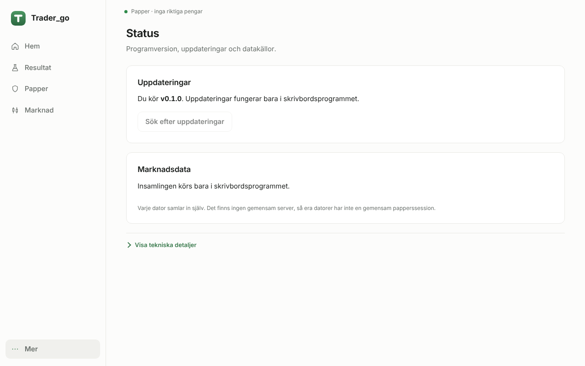 |

| Mer, 1280×800 | Mer, 390×844 | Papper, 1280×800 | Papper, 390×844 |
|---|---|---|---|
| 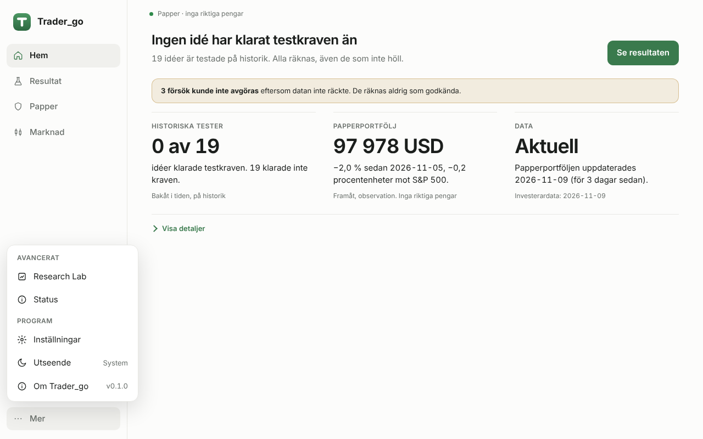 | 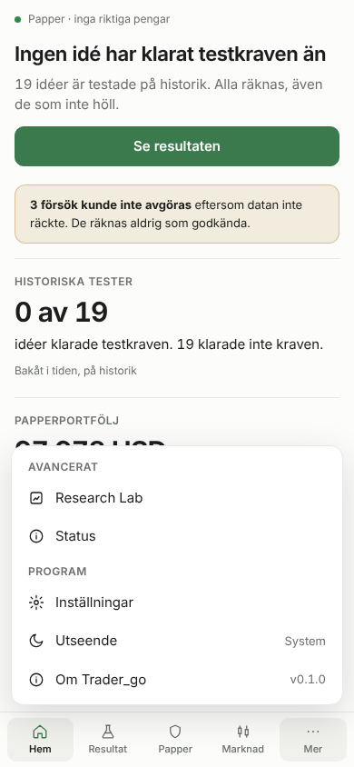 | 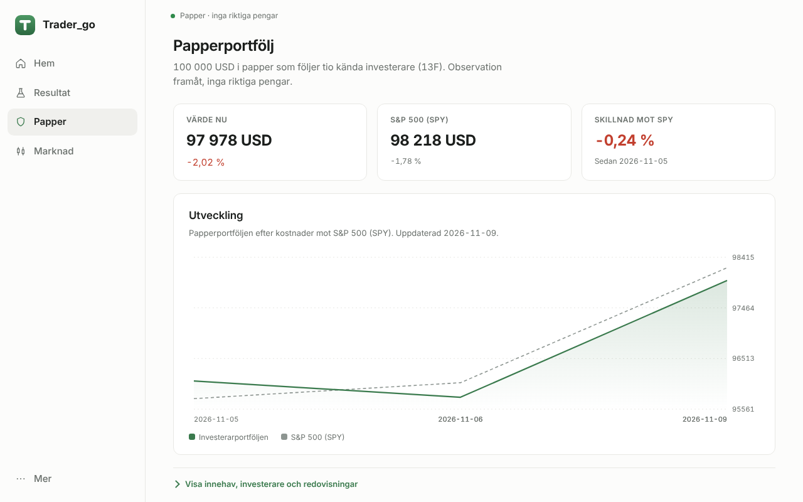 | 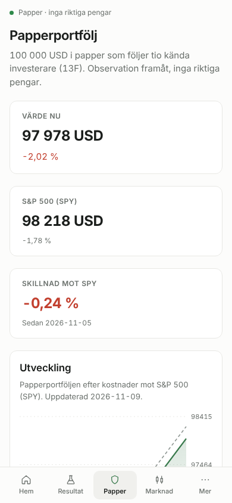 |

## Mörkt tema

| 1280×800 | 390×844 |
|---|---|
| 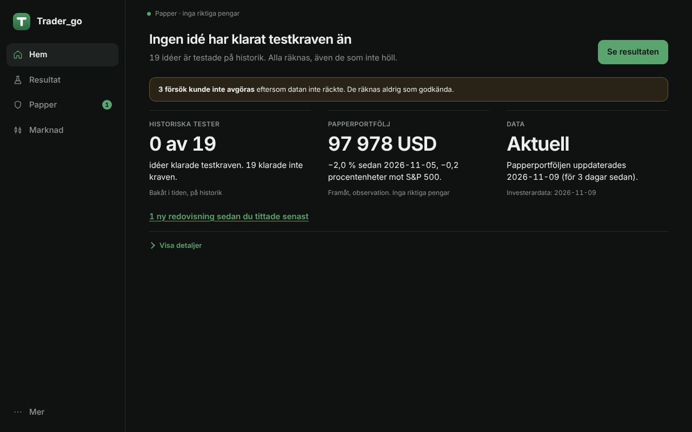 | 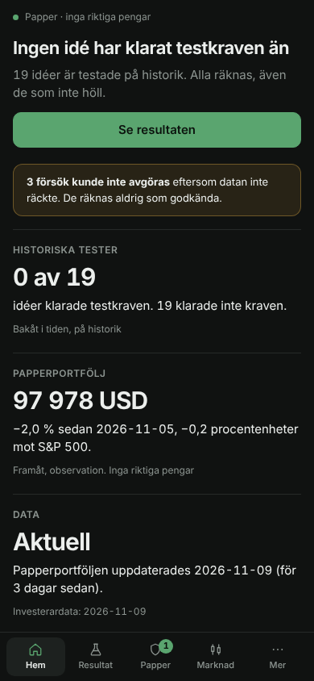 |
