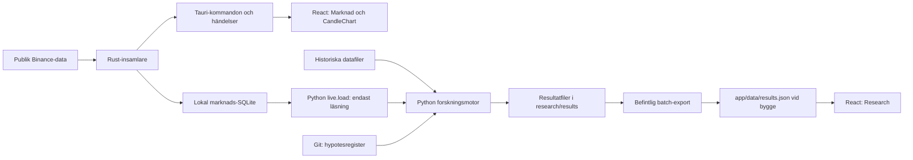

# TraderGO – arkitekturkartläggning för Research Engine

Kartlagt 2026-11-01 mot `main`, commit `f5831b5`. Detta är en kod- och schemagranskning,
inte ett godkännande av forskningsresultat eller en verifiering av molndrift.

## Checklista för steg 1

- [x] Analysera frontend, backend och mappstruktur.
- [x] Identifiera befintlig Supabase-kod och databastabeller.
- [x] Kartlägga befintliga trading- och analysfunktioner.
- [x] Identifiera återanvändbar kod och komponenter.
- [x] Planera Research Engine som en separat modul utan att ändra befintliga funktioner.

Alla fem punkter avser denna kartläggning och plan. Molnkoppling och ny modul är inte
driftsatta genom detta arbete. Övergripande Fas 1-status finns i [fas-1.md](fas-1.md).

## 1. Projekt och ansvar

Det gemensamma repot är `SEASTICK/Trader_go`. Aktiv huvudkopia är
`~/Documents/GitHub/Trader_go`, på `main`. Det separata repot
`edwinfighter42-star/traderGO` hör inte till denna arkitektur.

| Mapp | Befintligt ansvar |
|---|---|
| `app/` | React/TypeScript med Vite; samma frontend för webb och Tauri-desktop |
| `app/src-tauri/` | Rust-backend lokalt i desktopappen: SQLite, publik marknadsdata, papper och uppdateringar |
| `apps/trader-go-universe/` | Separat Tauri/React Flow-app som läser och visualiserar repot; får inte skriva till det |
| `engine/traderlab/` | Python-motor för historik, kvalitet, strategier, backtest, optimering, statistik och framåttest |
| `engine/tests/` | Motortester; flera delar använder syntetisk data |
| `research/` | Hypotesregister, experimentplaner, resultatfiler och forskningsanteckningar |
| `data/` | Manifest och databeskrivningar; rådata/ren data ligger lokalt och ignoreras av Git |
| `supabase/migrations/` | Förberett PostgreSQL-schema för en framtida serverkoppling |
| `.github/workflows/` | Kontroller, desktopbyggen och releaseflöden |
| `scripts/`, `docs/` | Lokal installation respektive projektets instruktioner |

Arbetsregler: [CLAUDE.md](../CLAUDE.md) och [samarbete.md](samarbete.md).
Ingen livehandel, inga mäklarorder eller börsnycklar ska införas i Research Engine.

## 2. Frontend och dataflöden

[`App.tsx`](../app/src/App.tsx) styr sidorna Översikt, Marknad, Research, Hypoteser,
Status och desktopdelen Papper. Sidval hanteras med React-state.

- Research importerar `app/data/experiments.json` och `app/data/results.json` vid
  bygge. `lib/experiments.ts` anpassar historiska resultat med `fromResult` och
  skapar SIM-data med `compute` där resultat saknas. SIM är inte forskningsbevis.
- Hypoteser och Översikt läser `research/registry.md` som bygginnehåll via `?raw`.
  En installerad app läser inte automatiskt ändringar i repots register/resultat.
- Marknad använder `CandleChart`, `lib/candles.ts`, `lib/barSubscription.ts` och
  `features/market/useMarketStatus.ts`. Backend erbjuder `market_status`,
  `market_series`, `market_bars` samt händelserna `market-status` och `market-bar`.
- Webbversionen har ingen Tauri-brygga. En framtida molnkoppling behöver därför en
  egen adapter och tydligt otillgängligt läge när den inte är konfigurerad.

## 3. Backend och lokala databaser

Det finns en lokal Rust-backend, inte en befintlig HTTP-server för Research Engine.
[`main.rs`](../app/src-tauri/src/main.rs) registrerar kommandon och startar insamlaren.
Python körs separat; Rust har inget kommando som startar Python-backtest i den
granskade versionen. Papper-sidans Starta backtest/session ändrar aktivitetsräknare
för uppdateringsspärren; det startar inte forskningsmotorn.

### Appdatabas: `tradergo.db`

Schema: [`db.rs`](../app/src-tauri/src/db.rs), version 1. De tre tabellerna bekräftades
även genom skrivskyddad läsning av den lokala installationens schemametadata.

| Tabell | Innehåll och användning |
|---|---|
| `settings` | Nyckel/värde; temaval i React lagras separat i localStorage |
| `paper_trades` | Manuellt loggade pappersaffärer; databasvillkor tillåter bara paper |
| `backtest_runs` | Förberedd lagring av strategi, sammanfattning och rapportväg; ingen ansluten körningskedja hittades |

Migreringar är append-only, transaktionella och säkerhetskopierar befintlig databas.
Behåll app-id och befintliga migreringar oförändrade.

### Marknadsdatabas: `market/market-data.sqlite`

Schema: [`schema.sql`](../app/src-tauri/src/market/schema.sql). Samtliga sex tabeller
bekräftades i lokal schemametadata; ingen användar- eller affärsdata lästes.

| Tabell | Ansvar |
|---|---|
| `bars` | Stängda kontrollerade OHLCV-staplar, nyckel per källa/marknad/symbol/intervall/tid |
| `live_bar` | Pågående stapel, separerad från analysunderlaget |
| `corrections` | Avvikande senare värden för redan sparade staplar |
| `confirmed_gaps` | Luckor som datakällan bekräftat |
| `fetch_log` | Hämtnings- och kvalitetslogg |
| `meta` | Metadata |

[`data/live.py`](../engine/traderlab/data/live.py) läser endast `bars` med SQLite
`mode=ro`, konverterar millisekunder till UTC-index och ger motorns OHLCV-format.
Motorn ska fortsätta läsa, inte skriva till appens marknadsdatabas.

## 4. Supabase – schema finns, integration saknas

[`0001_research.sql`](../supabase/migrations/0001_research.sql) definierar sju tabeller:

| Tabell | Ansvar och relation |
|---|---|
| `candles` | OHLCV, `closed` och mottagningstid; sammansatt serienyckel |
| `funding_rates` | Finansieringsränta per symbol och tid |
| `strategies` | Namn/version, beskrivning, standardparametrar och sökrymd |
| `hypotheses` | Spegling av Git-registret med registercommit och beslut |
| `runs` | Registrerade/utforskande jobb, parametrar, kostnader, period, status och skapare |
| `run_results` | Statistik, kriterier, kurvor och walk-forward-fönster; FK till `runs` |
| `run_trades` | Affärer och utgångsorsak per körning; FK till `runs` |

SQL-filen aktiverar RLS. Inloggade kan läsa alla dessa tabeller; läsningen är inte
avgränsad till en projektmedlem. Användaren kan köa egen utforskning och ändra status
för att avbryta egna köade/pågående körningar. Servern är tänkt att skriva med en
service-nyckel. Dessa policies är lästa som kod, inte provade i Supabase.

I spårad kod och beroendefiler hittades ingen Supabase-klient, autentiseringskedja,
serverworker, databasadapter eller driftskonfiguration som använder schemat. Ingen
fjärrdatabas har kontaktats, så tabellernas faktiska existens och migrationens
driftsstatus är okända. En SQL-fil bevisar inte en fungerande Supabase-integration.

Före drift måste medlemsåtkomst, jobbvalidering, atomisk jobbreservation, återförsök,
avbrott och föräldralösa jobb specificeras och verifieras. `runs.status` är en grund
för en kö, men är inte i sig en färdig jobbkö. Service-nycklar ska stanna på servern.

## 5. Befintlig trading och analys

| Förmåga | Befintlig kod | Gräns/återanvändning |
|---|---|---|
| Historik och kvalitet | `data/binance.py`, `bars.py`, `quality.py` | Publika datafiler, kontrollsummor och OHLCV/UTC-kontroller |
| Stapelvis backtest | `backtest.py`, `costs.py` | Nästa öppning, kostnader, funding, likvidation, stop/take-profit |
| Äldre strategier | `strategies/registry.py` | Buy-and-hold, MA, zscore, ML och funding; målpositionskontrakt |
| Fas 1-strategier | `strategies/rules.py`, `indicators.py` | `StrategySpec` → `Signals`; version/parameterhash; fyra regelstrategier |
| Optimering | `optimize.py`, `fas1.py` | Optuna, walk-forward och parameterstabilitet; Fas 1-körningen har fasta forskningsperioder |
| Statistik | `stats.py`, `report.py`, `metrics.py` | Osäkerhet, kostnadsstress, baslinje, riskmått, månadsutfall och regimer |
| Hypoteskrav | `registry.py` | Kräver committad hypotes och rent register före experiment |
| Resultat/export | `experiment.py`, `batch.py` | JSON i research och export för befintliga Research-rutor |
| Risk | `risk.py` | Separat overlay för målvolatilitet och förlustgränser |
| Framåttest | `paper/engine.py` | READY_FOR_PAPER, fryst specifikation med hash, händelselogg |

Ingen mäklare eller verklig orderexekvering ingår. Rust-appens manuella paper-journal
och Python-motorns frysta framåttest är två skilda flöden utan verifierad automatisk
synk. Befintlig testkod har inventerats men motortester och resultat har inte körts
om inom denna kartläggning.

## 6. Plan för en separat Research Engine-modul

Återanvänd Python-kärnan. Lägg ett separat orkestreringslager runt den; skapa inte
en ny backtestmotor i frontend eller Rust. Följande mappar och gränssnitt är förslag,
inte redan implementerade delar:

1. **Körningskontrakt:** definiera versionerade `RunRequest`, `RunProgress` och
   `RunResult`. Ta med hypotes eller utforskningsläge, strategi/version/parametrar,
   kostnader, perioder, kodcommit, dataversion och frö. Strategins parameterhash är
   inte ett komplett reproducerbart körnings-id eftersom data/kod/kostnader saknas.
2. **Orkestrering:** `engine/traderlab/research_engine/` får ansvar för validering,
   dataläsning, strategival, körning och resultatanpassning. Importera befintliga
   kärnfunktioner och behåll gamla CLI-/batch-anrop kompatibla.
3. **Lagringsadapter:** separera lokal filhantering från framtida Supabase-lagring.
   Git-registret förblir källa för hypoteser; molnet speglar registercommit. Läs bara
   stängda staplar och spara datasetets identitet innan körningen startar.
4. **Worker:** separat process i `services/research-worker/`, utanför Tauri. Den
   reserverar jobb atomiskt, kör Python, rapporterar status och sparar resultat.
   Lägg till heartbeat, tidsgränser, återhämtning och kontrollerat avbrott före drift.
5. **Frontend:** `app/src/features/research-engine/` med egen adapter, hook och vy.
   Återanvänd `Page`, `Segmented`, diagram och formatering. Behåll nuvarande Research,
   Papper, Marknad och uppdaterare fungerande när molnkopplingen är avstängd/saknas.
6. **Kompatibilitet:** skriv en explicit resultatadapter. `fas1.run` skriver
   `stats/criteria/curves`, medan `batch.export_to_app` läser äldre
   `summary/summary_stressed_costs/curve`. De formaten kan inte kopplas ihop direkt.
   `StrategySpec`/`Signals` behöver också en uttrycklig adapter till äldre
   `strategies.registry.build`; registrera inte nya strategier där utan stop/TP-stöd.
7. **Godkännande:** kontrollera oförändrade befintliga flöden och testa kontrakt,
   versionsfel, saknad data, kökonkurrens, avbrott, behörighet och återstart. Ingen
   körning får ändra hypotes eller fryst strategi, eller påverka insamlarens skrivare.

Lämplig första leverans är kontrakt + lokal adapter med en liten deterministisk
testkörning. Därefter worker/Supabase och sist en separat Research Lab-vy.

## 7. DigitalOcean-droplet

Användaren har en droplet. Den bifogade kontrollpanelsbilden visar aktiv status,
Ubuntu 24.04 LTS x64, FRA1, 2 vCPU, 4 GB RAM och 120 GB disk. Det är bildens uppgifter,
inte en SSH-verifiering. Serverns befintliga tjänster, ledigt utrymme, åtkomst,
brandvägg och säkerhetskopiering är ännu inte kontrollerade.

Planera inledningsvis en worker och en aktiv körning åt gången. Mät minne, CPU,
körtid och lagring på faktisk last innan parallell optimering aktiveras. Låt workern
vara en separat tjänst under egen användare med privat miljöfil, utgående åtkomst
till databas/datakälla och strukturerade loggar. Inga inkommande workerportar behövs
för en worker som hämtar jobb från databasen. Servern har inte ändrats i detta steg.

Inför serverkontroll behövs serverns SSH-värd/alias och användare samt bekräftad
nyckelåtkomst. Privata nycklar och service-hemligheter ska inte skickas i chatten.

## Verifiering och avgränsning

- Läste spårad källkod, beroenden, SQL, CLI och befintlig projektdokumentation.
- Sökte i spårade filer efter Supabase och serverkopplingar utan att läsa `.env`.
- Läste endast lokala SQLite-tabellnamn och schemaversioner med skrivskyddad anslutning.
- Ingen Supabase-migration, serverdrift, forskningskörning eller appändring utförd.
- Detta dokument kompletterar fas-1.md: där beskrivs Supabase som steg D; här
  preciseras att migrationsfilen redan finns men att anslutning/drift inte verifierats.
